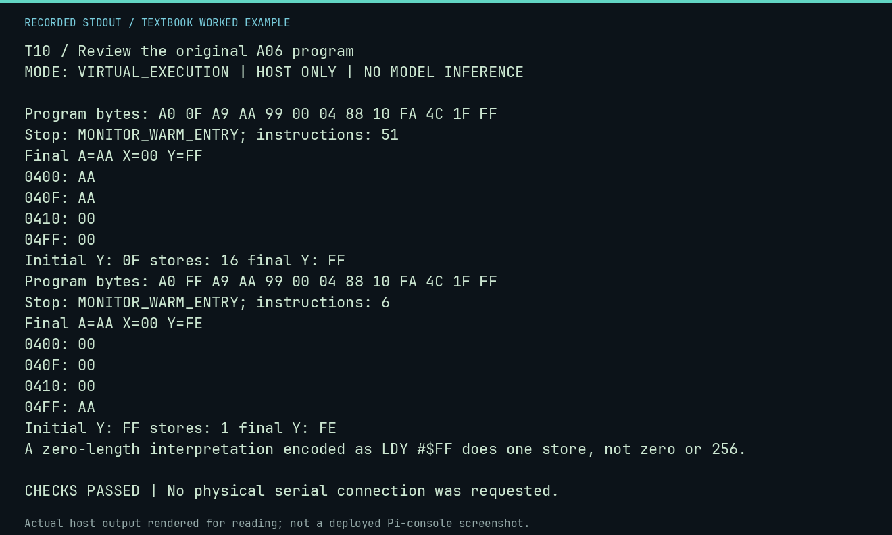

# T10 worked lab: Review the original A06 program

**Goal:** Execute the exact thirteen-byte answer and its zero-length pitfall.

**Mode:** `VIRTUAL_EXECUTION`. This companion runs on the host; it does not
change the original packet's paper activity or authorize physical Replica work.

## Understand the example

This is the original A06 countdown fill, not the five-byte fill in its older companion. Starting Y=$0F performs 16 stores and leaves Y=$FF. Encoding a supposed zero length as Y=$FF still enters the body once, writes $04FF, decrements to $FE and exits because N is set. A count parameter needs an explicit zero test and a clearly stated supported range.

## Predict before running

Read the source below. Write down the expected printed values and the condition
that would make its checks fail. For a CPU trace, distinguish state before an
instruction from state after it. For a conceptual exercise, explain the rule
behind each classification rather than memorizing the printed label.

## Run it

From the checkout root with your environment active:

```bash
python -m tools.textbook run T10
```

The runner executes this [complete source](../examples/T10.py):

```python
from tools.textbook_support import cpu

for index, expected_stores in [(0x0F, 16), (0xFF, 1)]:
    source = f"LDY #${index:02X}\nLDA #$AA\nFILL: STA $0400,Y\nDEY\nBPL FILL\nJMP $FF1F"
    w, r, a = cpu(source, inspect=(0x400, 0x40F, 0x410, 0x4FF))
    stores = [row for row in r.trace if row.opcode == 0x99]
    print("Initial Y:", f"{index:02X}", "stores:", len(stores), "final Y:", f"{r.final_y:02X}")
    assert len(a.payload) == 13 and len(stores) == expected_stores
    if index == 0x0F:
        assert w.host_read(0x400, 17) == b"\xAA" * 16 + b"\x00"
    else:
        assert w.host_read(0x4FF) == b"\xAA" and w.host_read(0x400) == b"\x00"
print("A zero-length interpretation encoded as LDY #$FF does one store, not zero or 256.")
```

## Recorded result

This output was actually executed and checked. The image is a readable render
of that stdout, not a screenshot of the deployed Pi console. A teaching fixture
or a host analogue is not independent historical or physical evidence.

```text
T10 / Review the original A06 program
MODE: VIRTUAL_EXECUTION | HOST ONLY | NO MODEL INFERENCE

Program bytes: A0 0F A9 AA 99 00 04 88 10 FA 4C 1F FF
Stop: MONITOR_WARM_ENTRY; instructions: 51
Final A=AA X=00 Y=FF
0400: AA
040F: AA
0410: 00
04FF: 00
Initial Y: 0F stores: 16 final Y: FF
Program bytes: A0 FF A9 AA 99 00 04 88 10 FA 4C 1F FF
Stop: MONITOR_WARM_ENTRY; instructions: 6
Final A=AA X=00 Y=FE
0400: 00
040F: 00
0410: 00
04FF: AA
Initial Y: FF stores: 1 final Y: FE
A zero-length interpretation encoded as LDY #$FF does one store, not zero or 256.

CHECKS PASSED | No physical serial connection was requested.
```



[Raw output](../captures/T10.txt) · [Capture manifest](../captures/manifest.json)

## Change one thing

Does this DEY/BPL loop support every length from 1 to 256?

<details>
<summary>Compare your reasoning with the worked answer</summary>

No. Its signed continuation test gives a restricted range and surprising behavior for high initial indices. Design a different loop with a zero precheck when a full byte count is required.

</details>

## Check your understanding

Explain the result without reading the code aloud. Name one condition that the
example did not test. Keep your prediction, changed input, actual output, and
interpretation together in your lab notebook. Use the linked textbook chapter
and the original source records for the broader context and evidence limits.

[Textbook home](../README.md) · Previous: [T09: Labels and branch arithmetic](T09.md) · Next: [T11: Derive the keyboard boundary](T11.md)
