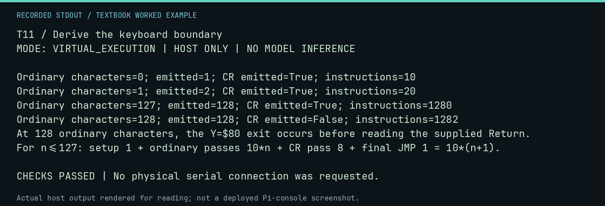

# T11 worked lab: Derive the keyboard boundary

**Goal:** Test empty input and both sides of the 128-character exit.

**Mode:** `VIRTUAL_EXECUTION`. This companion runs on the host; it does not
change the original packet's paper activity or authorize physical Replica work.

## Understand the example

For n<=127 ordinary characters, setup contributes 1 instruction, each ordinary pass contributes 10, the CR pass contributes 8, and the final JMP contributes 1. Thus 10*(n+1). With 128 ordinary characters, Y reaches $80 before the supplied CR is read, giving 1282 instructions and a buffer with no CR. The harness reads a maximum 128 buffer bytes.

## Predict before running

Read the source below. Write down the expected printed values and the condition
that would make its checks fail. For a CPU trace, distinguish state before an
instruction from state after it. For a conceptual exercise, explain the rule
behind each classification rather than memorizing the printed label.

## Run it

From the checkout root with your environment active:

```bash
python -m tools.textbook run T11
```

The runner executes this [complete source](../examples/T11.py):

```python
from tools.apple1_emulator import Apple1RamHarness
from tools.textbook_support import ROOT

harness = Apple1RamHarness.from_program_file(ROOT / "software/ram-only/line-input-0300.hex")
for count, expected_length, expected_steps in [(0, 1, 10), (1, 2, 20), (127, 128, 1280), (128, 128, 1282)]:
    r = harness.run_keyboard_line("A" * count + "\r")
    print(f"Ordinary characters={count}; emitted={len(r.screen_text)}; CR emitted={r.screen_text.endswith(chr(13))}; instructions={r.instructions}")
    assert len(r.screen_text) == expected_length and r.instructions == expected_steps and r.returned_to_monitor
    assert r.screen_text.endswith("\r") is (count < 128)
print("At 128 ordinary characters, the Y=$80 exit occurs before reading the supplied Return.")
print("For n<=127: setup 1 + ordinary passes 10*n + CR pass 8 + final JMP 1 = 10*(n+1).")
```

## Recorded result

This output was actually executed and checked. The image is a readable render
of that stdout, not a screenshot of the deployed Pi console. A teaching fixture
or a host analogue is not independent historical or physical evidence.

```text
T11 / Derive the keyboard boundary
MODE: VIRTUAL_EXECUTION | HOST ONLY | NO MODEL INFERENCE

Ordinary characters=0; emitted=1; CR emitted=True; instructions=10
Ordinary characters=1; emitted=2; CR emitted=True; instructions=20
Ordinary characters=127; emitted=128; CR emitted=True; instructions=1280
Ordinary characters=128; emitted=128; CR emitted=False; instructions=1282
At 128 ordinary characters, the Y=$80 exit occurs before reading the supplied Return.
For n<=127: setup 1 + ordinary passes 10*n + CR pass 8 + final JMP 1 = 10*(n+1).

CHECKS PASSED | No physical serial connection was requested.
```



[Raw output](../captures/T11.txt) · [Capture manifest](../captures/manifest.json)

## Change one thing

What happens for 127 ordinary characters followed by Return?

<details>
<summary>Compare your reasoning with the worked answer</summary>

It stores and echoes 128 bytes including the CR, returns to Monitor, and uses 1280 instructions. This differs from 128 ordinary characters followed by Return.

</details>

## Check your understanding

Explain the result without reading the code aloud. Name one condition that the
example did not test. Keep your prediction, changed input, actual output, and
interpretation together in your lab notebook. Use the linked textbook chapter
and the original source records for the broader context and evidence limits.

[Textbook home](../README.md) · Previous: [T10: Review the original A06 program](T10.md) · Next: [T12: Reset, BRK and interrupt return](T12.md)
