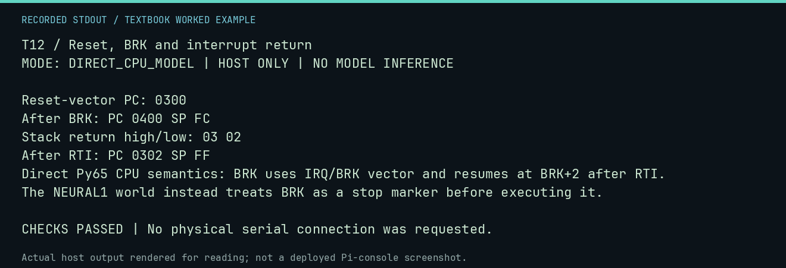

# T12 worked lab: Reset, BRK and interrupt return

**Goal:** Distinguish vectors and actual CPU BRK from a lab stop marker.

**Mode:** `DIRECT_CPU_MODEL`. This companion runs on the host; it does not
change the original packet's paper activity or authorize physical Replica work.

## Understand the example

This example steps Py65 directly with an explicit reset vector, IRQ/BRK vector and RTI handler. BRK saves a return PC of BRK+2 plus status, and RTI restores it. The repository world deliberately stops before executing BRK, so its BRK stop report does not demonstrate an interrupt handler. This is a software semantic check, not a hardware reset or IRQ measurement.

## Predict before running

Read the source below. Write down the expected printed values and the condition
that would make its checks fail. For a CPU trace, distinguish state before an
instruction from state after it. For a conceptual exercise, explain the rule
behind each classification rather than memorizing the printed label.

## Run it

From the checkout root with your environment active:

```bash
python -m tools.textbook run T12
```

The runner executes this [complete source](../examples/T12.py):

```python
from py65.devices.mpu6502 import MPU

memory = [0] * 65536
memory[0xFFFC:0xFFFE] = [0x00, 0x03]
memory[0xFFFE:0x10000] = [0x00, 0x04]
memory[0x300:0x303] = [0x00, 0xEA, 0xEA]  # BRK, padding, next instruction
memory[0x400] = 0x40  # RTI
mpu = MPU(memory=memory, pc=None)
print("Reset-vector PC:", f"{mpu.pc:04X}")
assert mpu.pc == 0x300
mpu.step()
print("After BRK: PC", f"{mpu.pc:04X}", "SP", f"{mpu.sp:02X}")
print("Stack return high/low:", f"{memory[0x1FF]:02X} {memory[0x1FE]:02X}")
assert mpu.pc == 0x400 and mpu.sp == 0xFC
assert memory[0x1FF:0x200] == [0x03] and memory[0x1FE] == 0x02
mpu.step()
print("After RTI: PC", f"{mpu.pc:04X}", "SP", f"{mpu.sp:02X}")
assert mpu.pc == 0x302 and mpu.sp == 0xFF
print("Direct Py65 CPU semantics: BRK uses IRQ/BRK vector and resumes at BRK+2 after RTI.")
print("The NEURAL1 world instead treats BRK as a stop marker before executing it.")
```

## Recorded result

This output was actually executed and checked. The image is a readable render
of that stdout, not a screenshot of the deployed Pi console. A teaching fixture
or a host analogue is not independent historical or physical evidence.

```text
T12 / Reset, BRK and interrupt return
MODE: DIRECT_CPU_MODEL | HOST ONLY | NO MODEL INFERENCE

Reset-vector PC: 0300
After BRK: PC 0400 SP FC
Stack return high/low: 03 02
After RTI: PC 0302 SP FF
Direct Py65 CPU semantics: BRK uses IRQ/BRK vector and resumes at BRK+2 after RTI.
The NEURAL1 world instead treats BRK as a stop marker before executing it.

CHECKS PASSED | No physical serial connection was requested.
```



[Raw output](../captures/T12.txt) · [Capture manifest](../captures/manifest.json)

## Change one thing

Can a world result with stop_reason BRK prove an interrupt handler executed?

<details>
<summary>Compare your reasoning with the worked answer</summary>

No. That world intercepts BRK before the CPU instruction runs. Use the direct CPU exercise to study the instruction and identify the different evidence mode.

</details>

## Check your understanding

Explain the result without reading the code aloud. Name one condition that the
example did not test. Keep your prediction, changed input, actual output, and
interpretation together in your lab notebook. Use the linked textbook chapter
and the original source records for the broader context and evidence limits.

[Textbook home](../README.md) · Previous: [T11: Derive the keyboard boundary](T11.md) · Next: [N01: Inspect fresh local-model evidence](N01.md)
