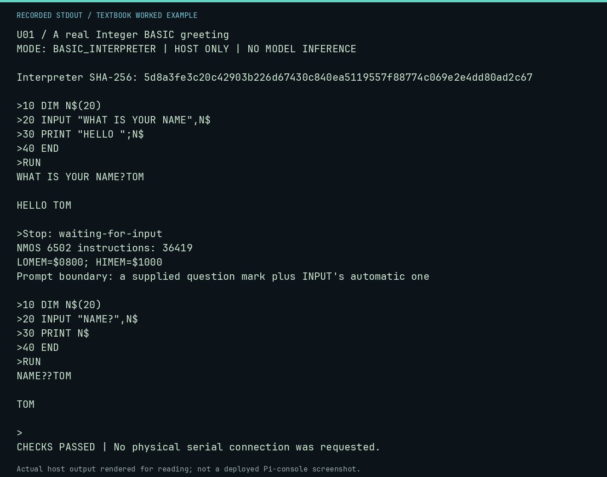

# U01 worked lab: A real Integer BASIC greeting

**Goal:** Run INPUT and DIM on the preserved interpreter.

**Mode:** `BASIC_INTERPRETER`. This companion runs on the host; it does not
change the original packet's paper activity or authorize physical Replica work.

## Understand the example

A string must be dimensioned before INPUT. This session runs the identified Apple-1 interpreter on a modeled NMOS 6502; its echo, automatic question mark and greeting are interpreter output.

## Predict before running

Read the source below. Write down the expected printed values and the condition
that would make its checks fail. For a CPU trace, distinguish state before an
instruction from state after it. For a conceptual exercise, explain the rule
behind each classification rather than memorizing the printed label.

## Run it

From the checkout root with your environment active:

```bash
python -m tools.textbook run U01
```

The runner executes this [complete source](../examples/U01.py):

```python
from tools.apple1_basic import ROM_SHA256, run_session
from tools.textbook_support import ROOT

session = ROOT / "software/basic/HELLO.session"
result = run_session(session.read_text(encoding="ascii").splitlines())
print("Interpreter SHA-256:", ROM_SHA256)
print(result.transcript, end="")
print("Stop:", result.stop)
print("NMOS 6502 instructions:", result.instructions)
print(f"LOMEM=${result.lomem:04X}; HIMEM=${result.himem:04X}")
assert "HELLO TOM" in result.transcript
assert "***" not in result.transcript
assert result.stop == "waiting-for-input"

print("Prompt boundary: a supplied question mark plus INPUT's automatic one")
doubled = run_session(['10 DIM N$(20)', '20 INPUT "NAME?",N$', '30 PRINT N$', '40 END', 'RUN', 'TOM'])
print(doubled.transcript, end="")
assert "NAME??TOM" in doubled.transcript
```

## Recorded result

This output was actually executed and checked. The image is a readable render
of that stdout, not a screenshot of the deployed Pi console. A teaching fixture
or a host analogue is not independent historical or physical evidence.

```text
U01 / A real Integer BASIC greeting
MODE: BASIC_INTERPRETER | HOST ONLY | NO MODEL INFERENCE

Interpreter SHA-256: 5d8a3fe3c20c42903b226d67430c840ea5119557f88774c069e2e4dd80ad2c67

>10 DIM N$(20)
>20 INPUT "WHAT IS YOUR NAME",N$
>30 PRINT "HELLO ";N$
>40 END
>RUN
WHAT IS YOUR NAME?TOM

HELLO TOM

>Stop: waiting-for-input
NMOS 6502 instructions: 36419
LOMEM=$0800; HIMEM=$1000
Prompt boundary: a supplied question mark plus INPUT's automatic one

>10 DIM N$(20)
>20 INPUT "NAME?",N$
>30 PRINT N$
>40 END
>RUN
NAME??TOM

TOM

>
CHECKS PASSED | No physical serial connection was requested.
```



[Raw output](../captures/U01.txt) · [Capture manifest](../captures/manifest.json)

## Change one thing

Put a question mark at the end of the prompt. What changes?

<details>
<summary>Compare your reasoning with the worked answer</summary>

The prompt supplies one question mark and INPUT supplies another. The exact NAME?? behavior is covered by the BASIC boundary tests.

</details>

## Check your understanding

Explain the result without reading the code aloud. Name one condition that the
example did not test. Keep your prediction, changed input, actual output, and
interpretation together in your lab notebook. Use the linked textbook chapter
and the original source records for the broader context and evidence limits.

[Textbook home](../README.md) · Previous: [N02: Read the installed Pi tutor and trace](N02.md) · Next: [U02: Integer conversion with a checked domain](U02.md)
