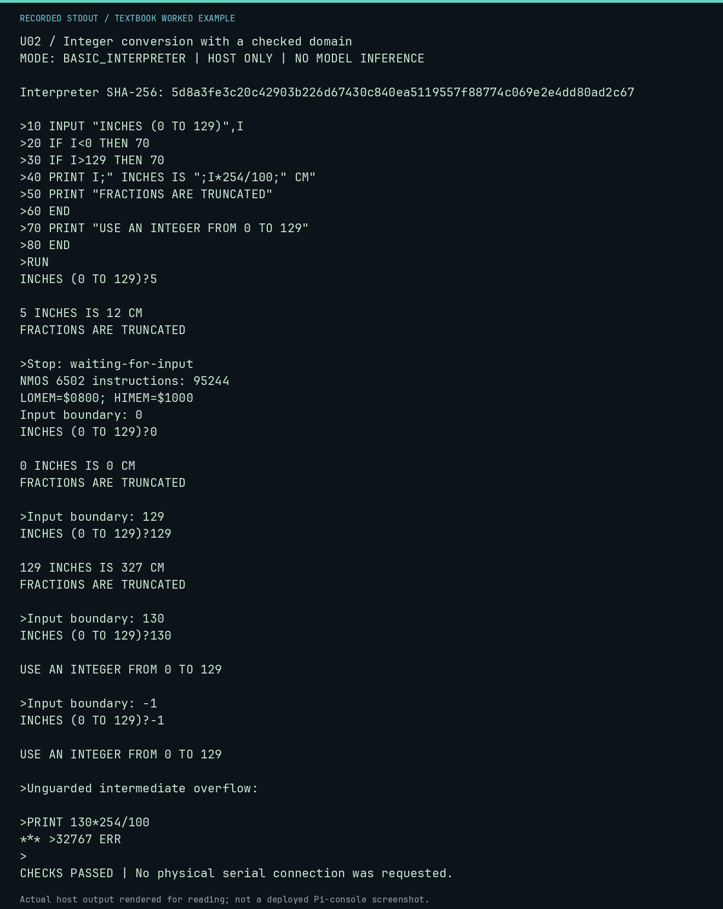

# U02 worked lab: Integer conversion with a checked domain

**Goal:** Prevent intermediate arithmetic overflow.

**Mode:** `BASIC_INTERPRETER`. This companion runs on the host; it does not
change the original packet's paper activity or authorize physical Replica work.

## Understand the example

Integer division truncates. Multiplication happens before division here: 129*254 fits, but 130*254 exceeds 32767. The program checks 0 through 129 before computing.

## Predict before running

Read the source below. Write down the expected printed values and the condition
that would make its checks fail. For a CPU trace, distinguish state before an
instruction from state after it. For a conceptual exercise, explain the rule
behind each classification rather than memorizing the printed label.

## Run it

From the checkout root with your environment active:

```bash
python -m tools.textbook run U02
```

The runner executes this [complete source](../examples/U02.py):

```python
from tools.apple1_basic import ROM_SHA256, run_session
from tools.textbook_support import ROOT

session = ROOT / "software/basic/CONVERT.session"
result = run_session(session.read_text(encoding="ascii").splitlines())
print("Interpreter SHA-256:", ROM_SHA256)
print(result.transcript, end="")
print("Stop:", result.stop)
print("NMOS 6502 instructions:", result.instructions)
print(f"LOMEM=${result.lomem:04X}; HIMEM=${result.himem:04X}")
assert "5 INCHES IS 12 CM" in result.transcript
assert "***" not in result.transcript
assert result.stop == "waiting-for-input"

program = (ROOT / "software/basic/CONVERT.bas").read_text().splitlines()
for value in ("0", "129", "130", "-1"):
    boundary = run_session([*program, "RUN", value])
    print("Input boundary:", value)
    print(boundary.transcript.split(">RUN\n", 1)[1], end="")
    assert "***" not in boundary.transcript
overflow = run_session(["PRINT 130*254/100"])
print("Unguarded intermediate overflow:")
print(overflow.transcript, end="")
assert "*** >32767 ERR" in overflow.transcript
```

## Recorded result

This output was actually executed and checked. The image is a readable render
of that stdout, not a screenshot of the deployed Pi console. A teaching fixture
or a host analogue is not independent historical or physical evidence.

```text
U02 / Integer conversion with a checked domain
MODE: BASIC_INTERPRETER | HOST ONLY | NO MODEL INFERENCE

Interpreter SHA-256: 5d8a3fe3c20c42903b226d67430c840ea5119557f88774c069e2e4dd80ad2c67

>10 INPUT "INCHES (0 TO 129)",I
>20 IF I<0 THEN 70
>30 IF I>129 THEN 70
>40 PRINT I;" INCHES IS ";I*254/100;" CM"
>50 PRINT "FRACTIONS ARE TRUNCATED"
>60 END
>70 PRINT "USE AN INTEGER FROM 0 TO 129"
>80 END
>RUN
INCHES (0 TO 129)?5

5 INCHES IS 12 CM
FRACTIONS ARE TRUNCATED

>Stop: waiting-for-input
NMOS 6502 instructions: 95244
LOMEM=$0800; HIMEM=$1000
Input boundary: 0
INCHES (0 TO 129)?0

0 INCHES IS 0 CM
FRACTIONS ARE TRUNCATED

>Input boundary: 129
INCHES (0 TO 129)?129

129 INCHES IS 327 CM
FRACTIONS ARE TRUNCATED

>Input boundary: 130
INCHES (0 TO 129)?130

USE AN INTEGER FROM 0 TO 129

>Input boundary: -1
INCHES (0 TO 129)?-1

USE AN INTEGER FROM 0 TO 129

>Unguarded intermediate overflow:

>PRINT 130*254/100
*** >32767 ERR
>
CHECKS PASSED | No physical serial connection was requested.
```



[Raw output](../captures/U02.txt) · [Capture manifest](../captures/manifest.json)

## Change one thing

Try 0, 129, 130 and -1. Which inputs reach the calculation?

<details>
<summary>Compare your reasoning with the worked answer</summary>

0 and 129 yield 0 and 327 cm. 130 and -1 print the domain message. Fractional input is outside this integer-only program contract.

</details>

## Check your understanding

Explain the result without reading the code aloud. Name one condition that the
example did not test. Keep your prediction, changed input, actual output, and
interpretation together in your lab notebook. Use the linked textbook chapter
and the original source records for the broader context and evidence limits.

[Textbook home](../README.md) · Previous: [U01: A real Integer BASIC greeting](U01.md) · Next: [U03: A running sum in BASIC](U03.md)
