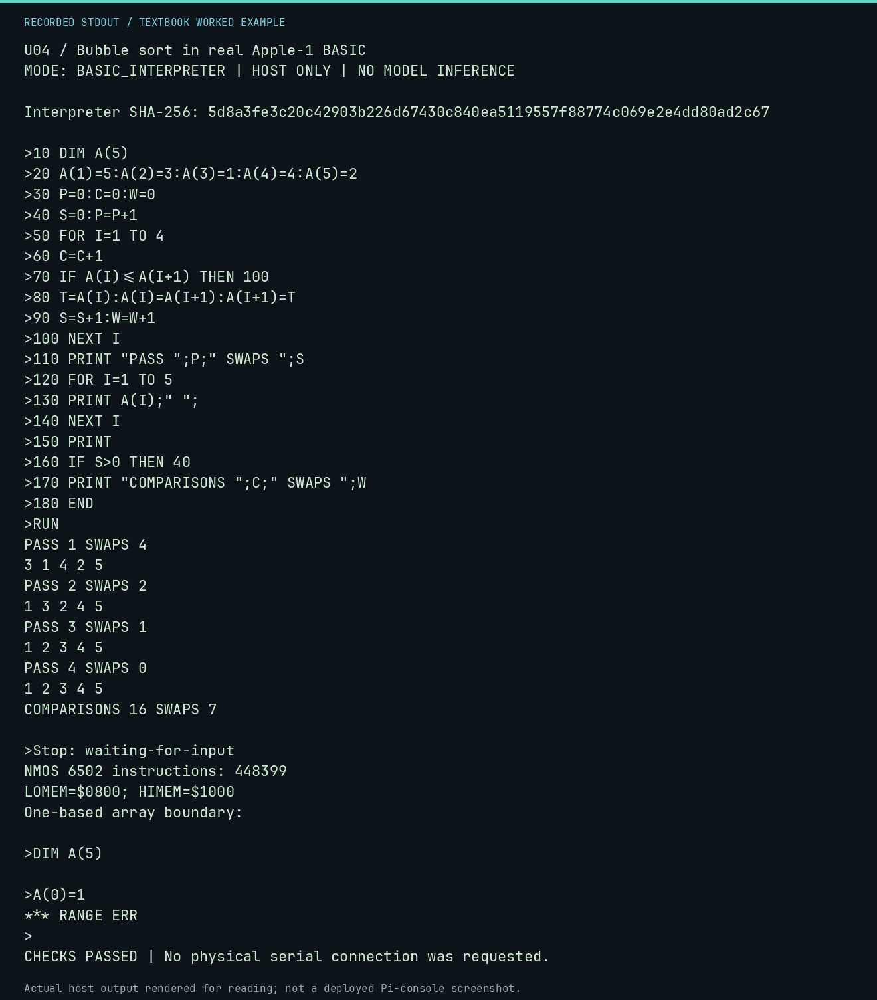

# U04 worked lab: Bubble sort in real Apple-1 BASIC

**Goal:** Compare each pass with the B04 paper trace.

**Mode:** `BASIC_INTERPRETER`. This companion runs on the host; it does not
change the original packet's paper activity or authorize physical Replica work.

## Understand the example

The real interpreter executes adjacent comparisons and swaps. Integer arrays are one-based: DIM A(5) permits indices 1 through 5; index 0 raises RANGE ERR. The final no-swap pass is retained.

## Predict before running

Read the source below. Write down the expected printed values and the condition
that would make its checks fail. For a CPU trace, distinguish state before an
instruction from state after it. For a conceptual exercise, explain the rule
behind each classification rather than memorizing the printed label.

## Run it

From the checkout root with your environment active:

```bash
python -m tools.textbook run U04
```

The runner executes this [complete source](../examples/U04.py):

```python
from tools.apple1_basic import ROM_SHA256, run_session
from tools.textbook_support import ROOT

session = ROOT / "software/basic/SORT.session"
result = run_session(session.read_text(encoding="ascii").splitlines())
print("Interpreter SHA-256:", ROM_SHA256)
print(result.transcript, end="")
print("Stop:", result.stop)
print("NMOS 6502 instructions:", result.instructions)
print(f"LOMEM=${result.lomem:04X}; HIMEM=${result.himem:04X}")
assert "COMPARISONS 16 SWAPS 7" in result.transcript
assert "***" not in result.transcript
assert result.stop == "waiting-for-input"

boundary = run_session(["DIM A(5)", "A(0)=1"])
print("One-based array boundary:")
print(boundary.transcript, end="")
assert "*** RANGE ERR" in boundary.transcript
```

## Recorded result

This output was actually executed and checked. The image is a readable render
of that stdout, not a screenshot of the deployed Pi console. A teaching fixture
or a host analogue is not independent historical or physical evidence.

```text
U04 / Bubble sort in real Apple-1 BASIC
MODE: BASIC_INTERPRETER | HOST ONLY | NO MODEL INFERENCE

Interpreter SHA-256: 5d8a3fe3c20c42903b226d67430c840ea5119557f88774c069e2e4dd80ad2c67

>10 DIM A(5)
>20 A(1)=5:A(2)=3:A(3)=1:A(4)=4:A(5)=2
>30 P=0:C=0:W=0
>40 S=0:P=P+1
>50 FOR I=1 TO 4
>60 C=C+1
>70 IF A(I)<=A(I+1) THEN 100
>80 T=A(I):A(I)=A(I+1):A(I+1)=T
>90 S=S+1:W=W+1
>100 NEXT I
>110 PRINT "PASS ";P;" SWAPS ";S
>120 FOR I=1 TO 5
>130 PRINT A(I);" ";
>140 NEXT I
>150 PRINT
>160 IF S>0 THEN 40
>170 PRINT "COMPARISONS ";C;" SWAPS ";W
>180 END
>RUN
PASS 1 SWAPS 4
3 1 4 2 5 
PASS 2 SWAPS 2
1 3 2 4 5 
PASS 3 SWAPS 1
1 2 3 4 5 
PASS 4 SWAPS 0
1 2 3 4 5 
COMPARISONS 16 SWAPS 7

>Stop: waiting-for-input
NMOS 6502 instructions: 448399
LOMEM=$0800; HIMEM=$1000
One-based array boundary:

>DIM A(5)

>A(0)=1
*** RANGE ERR
>
CHECKS PASSED | No physical serial connection was requested.
```



[Raw output](../captures/U04.txt) · [Capture manifest](../captures/manifest.json)

## Change one thing

Try the already sorted and reverse-sorted starting orders from B04.

<details>
<summary>Compare your reasoning with the worked answer</summary>

Already sorted: 4 comparisons, 0 swaps. Reverse order: 20 comparisons, 10 swaps, including the final no-swap pass.

</details>

## Check your understanding

Explain the result without reading the code aloud. Name one condition that the
example did not test. Keep your prediction, changed input, actual output, and
interpretation together in your lab notebook. Use the linked textbook chapter
and the original source records for the broader context and evidence limits.

[Textbook home](../README.md) · Previous: [U03: A running sum in BASIC](U03.md) · Next: [U05: A BASIC quiz with both outcomes](U05.md)
