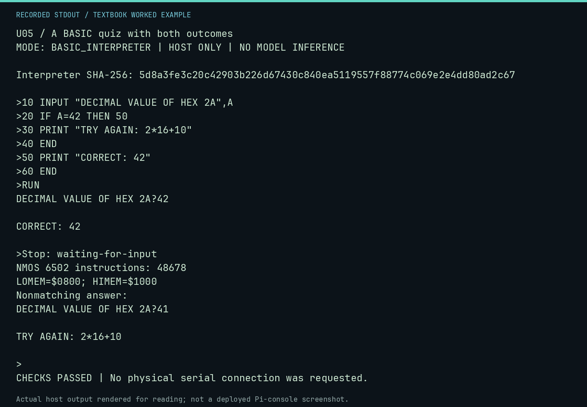

# U05 worked lab: A BASIC quiz with both outcomes

**Goal:** Exercise a conditional and a nonmatching answer.

**Mode:** `BASIC_INTERPRETER`. This companion runs on the host; it does not
change the original packet's paper activity or authorize physical Replica work.

## Understand the example

The interpreter reads an integer and selects a response. A successful answer alone would not validate the other branch, so the tests exercise a wrong answer too.

## Predict before running

Read the source below. Write down the expected printed values and the condition
that would make its checks fail. For a CPU trace, distinguish state before an
instruction from state after it. For a conceptual exercise, explain the rule
behind each classification rather than memorizing the printed label.

## Run it

From the checkout root with your environment active:

```bash
python -m tools.textbook run U05
```

The runner executes this [complete source](../examples/U05.py):

```python
from tools.apple1_basic import ROM_SHA256, run_session
from tools.textbook_support import ROOT

session = ROOT / "software/basic/QUIZ.session"
result = run_session(session.read_text(encoding="ascii").splitlines())
print("Interpreter SHA-256:", ROM_SHA256)
print(result.transcript, end="")
print("Stop:", result.stop)
print("NMOS 6502 instructions:", result.instructions)
print(f"LOMEM=${result.lomem:04X}; HIMEM=${result.himem:04X}")
assert "CORRECT: 42" in result.transcript
assert "***" not in result.transcript
assert result.stop == "waiting-for-input"

source = (ROOT / "software/basic/QUIZ.bas").read_text().splitlines()
wrong = run_session([*source, "RUN", "41"])
print("Nonmatching answer:")
print(wrong.transcript.split(">RUN\n", 1)[1], end="")
assert "TRY AGAIN: 2*16+10" in wrong.transcript
```

## Recorded result

This output was actually executed and checked. The image is a readable render
of that stdout, not a screenshot of the deployed Pi console. A teaching fixture
or a host analogue is not independent historical or physical evidence.

```text
U05 / A BASIC quiz with both outcomes
MODE: BASIC_INTERPRETER | HOST ONLY | NO MODEL INFERENCE

Interpreter SHA-256: 5d8a3fe3c20c42903b226d67430c840ea5119557f88774c069e2e4dd80ad2c67

>10 INPUT "DECIMAL VALUE OF HEX 2A",A
>20 IF A=42 THEN 50
>30 PRINT "TRY AGAIN: 2*16+10"
>40 END
>50 PRINT "CORRECT: 42"
>60 END
>RUN
DECIMAL VALUE OF HEX 2A?42

CORRECT: 42

>Stop: waiting-for-input
NMOS 6502 instructions: 48678
LOMEM=$0800; HIMEM=$1000
Nonmatching answer:
DECIMAL VALUE OF HEX 2A?41

TRY AGAIN: 2*16+10

>
CHECKS PASSED | No physical serial connection was requested.
```



[Raw output](../captures/U05.txt) · [Capture manifest](../captures/manifest.json)

## Change one thing

Answer 41, then rerun and answer 42.

<details>
<summary>Compare your reasoning with the worked answer</summary>

41 prints the hint 2*16+10; 42 prints CORRECT: 42. Both reach END and return to the BASIC prompt.

</details>

## Check your understanding

Explain the result without reading the code aloud. Name one condition that the
example did not test. Keep your prediction, changed input, actual output, and
interpretation together in your lab notebook. Use the linked textbook chapter
and the original source records for the broader context and evidence limits.

[Textbook home](../README.md) · Previous: [U04: Bubble sort in real Apple-1 BASIC](U04.md) · Next: [U06: Generate a triangular pattern in BASIC](U06.md)
