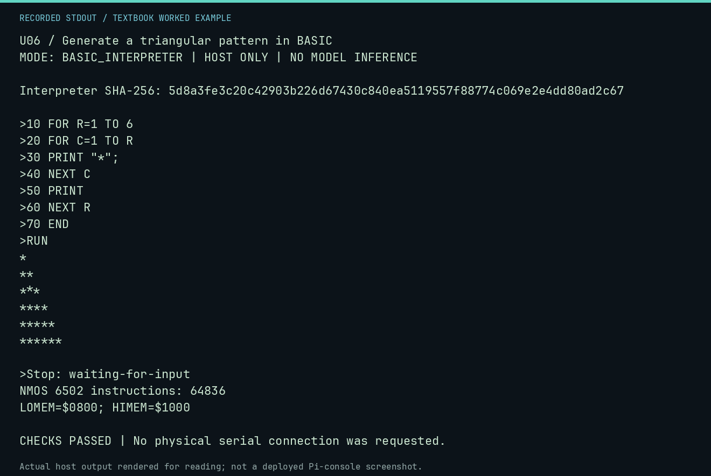

# U06 worked lab: Generate a triangular pattern in BASIC

**Goal:** Produce text from nested loop state.

**Mode:** `BASIC_INTERPRETER`. This companion runs on the host; it does not
change the original packet's paper activity or authorize physical Replica work.

## Understand the example

A row loop chooses the length and a column loop prints that many stars. PRINT with a semicolon stays on the line; a bare PRINT ends it. The interpreter emits all characters.

## Predict before running

Read the source below. Write down the expected printed values and the condition
that would make its checks fail. For a CPU trace, distinguish state before an
instruction from state after it. For a conceptual exercise, explain the rule
behind each classification rather than memorizing the printed label.

## Run it

From the checkout root with your environment active:

```bash
python -m tools.textbook run U06
```

The runner executes this [complete source](../examples/U06.py):

```python
from tools.apple1_basic import ROM_SHA256, run_session
from tools.textbook_support import ROOT

session = ROOT / "software/basic/PATTERN.session"
result = run_session(session.read_text(encoding="ascii").splitlines())
print("Interpreter SHA-256:", ROM_SHA256)
print(result.transcript, end="")
print("Stop:", result.stop)
print("NMOS 6502 instructions:", result.instructions)
print(f"LOMEM=${result.lomem:04X}; HIMEM=${result.himem:04X}")
assert "******" in result.transcript
assert result.transcript.split(">RUN\n", 1)[1].split("\n\n>", 1)[0].splitlines() == ["*" * n for n in range(1, 7)]
assert result.stop == "waiting-for-input"
```

## Recorded result

This output was actually executed and checked. The image is a readable render
of that stdout, not a screenshot of the deployed Pi console. A teaching fixture
or a host analogue is not independent historical or physical evidence.

```text
U06 / Generate a triangular pattern in BASIC
MODE: BASIC_INTERPRETER | HOST ONLY | NO MODEL INFERENCE

Interpreter SHA-256: 5d8a3fe3c20c42903b226d67430c840ea5119557f88774c069e2e4dd80ad2c67

>10 FOR R=1 TO 6
>20 FOR C=1 TO R
>30 PRINT "*";
>40 NEXT C
>50 PRINT
>60 NEXT R
>70 END
>RUN
*
**
***
****
*****
******

>Stop: waiting-for-input
NMOS 6502 instructions: 64836
LOMEM=$0800; HIMEM=$1000

CHECKS PASSED | No physical serial connection was requested.
```



[Raw output](../captures/U06.txt) · [Capture manifest](../captures/manifest.json)

## Change one thing

How many stars are generated, and how many loop rows?

<details>
<summary>Compare your reasoning with the worked answer</summary>

Six rows and 21 stars. This is a deterministic generator, not randomness or learning.

</details>

## Check your understanding

Explain the result without reading the code aloud. Name one condition that the
example did not test. Keep your prediction, changed input, actual output, and
interpretation together in your lab notebook. Use the linked textbook chapter
and the original source records for the broader context and evidence limits.

[Textbook home](../README.md) · Previous: [U05: A BASIC quiz with both outcomes](U05.md) · Next: [K01: Compile every lesson for a 40x24 screen](K01.md)
