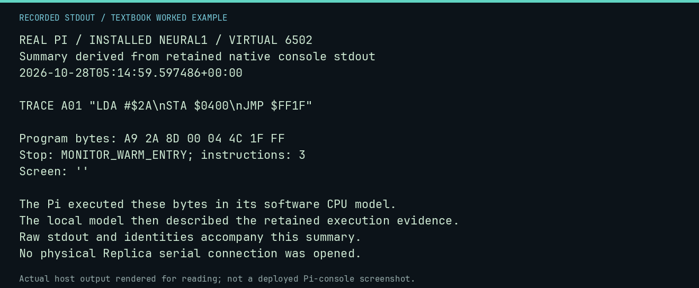
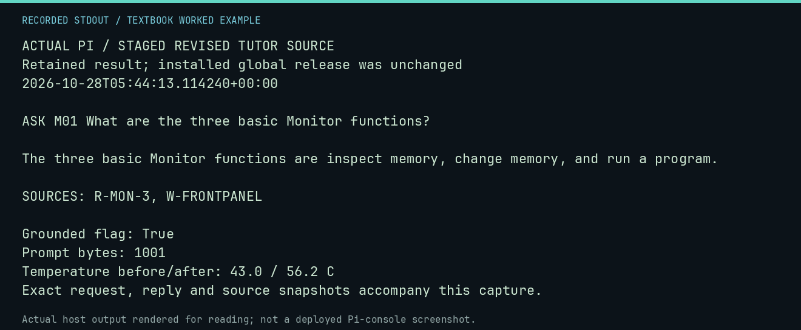

# Follow a real local model through the verifier

The automatic book examples use deterministic fixtures. This chapter adds
actual local inference with retained requests, raw replies and independently
checked proposals. Read the records first; running N01 needs no model service.

```bash
python -m tools.textbook run N01
```

N01 re-evaluates retained model text. Its checks pass when the recorded finding
is reproduced. That is different from the proposed 6502 program passing its
task. A failed model proposal is an informative result, not a broken lesson.

## The task was declared before inference

Fill exactly `$0400` through `$0404` with `$2A`, leave other memory unchanged,
and transfer to Monitor warm entry. Deposit code only in `$0300`–`$03FF`.
Use a maximum 200-instruction independent execution. The verifier checks:

1. At least one valid code deposit and exactly one `0300R` request.
2. No disallowed parsed commands or deposits outside the code area.
3. A Monitor warm-entry stop.
4. Five correct data bytes with `$A5` sentinels unchanged on both sides.
5. Exactly one CPU write to each intended destination, and no other CPU writes.

It reloads the deposited program into its own fresh world. A model cannot pass
by depositing the answer directly into the destination. Host shell text is never
executed. This is a constrained teaching task; its exact-write rule deliberately
excludes implementations using extra scratch writes or a call stack.


## Read the workstation records

The recorded model is `qwen2.5-coder:1.5b`, manifest digest
`d7372fd828518a4d38b1eb196c673c31a85f2ed302b3d1e406c4c2d1b64a0668`,
quantization Q4_K_M. The cached weights were reused, with no model download.
The runtime was Ollama 0.33.2 on an x86_64 workstation. Each request used context
2048, at most 192 output tokens, temperature 0, seed 7, four CPU threads and
`keep_alive=0`.

Both `/api/generate` and `/api/chat` received the same two task prompts: one
unassisted and one with the algorithm and opcode reference supplied. Each API
also received a small arithmetic health control. In the retained runs both
controls returned `4`; all four program proposals failed the declared task.
The replies hit the output limit without supplying an accepted complete program.
This establishes a bounded negative finding for these prompts/configuration.
It is not a model ranking or evidence that the model family can never program.

| Record | Readable capture | Raw evidence |
|---|---|---|
| Workstation generate API | [Image](evidence/generate/summary.png) / [text](evidence/generate/summary.txt) | [Receipt](evidence/generate/receipt.json), [control](evidence/generate/health-control.json), [unassisted](evidence/generate/unassisted.json), [scaffolded](evidence/generate/scaffolded.json) |
| Workstation chat API | [Image](evidence/chat/summary.png) / [text](evidence/chat/summary.txt) | [Receipt](evidence/chat/receipt.json), [control](evidence/chat/health-control.json), [unassisted](evidence/chat/unassisted.json), [scaffolded](evidence/chat/scaffolded.json) |

Each complete receipt identifies the model manifest and every cached blob,
records raw provider responses and timing/token metadata, and retains the
capture/evaluator source files used for that observation. A digest identifies
bytes; it does not confer rights, independently authenticate an upstream model,
or certify that a generated explanation is correct.

## Inspect the fresh Pi recordings

The [Pi proposal receipt](evidence/pi-phi4/receipt.json) identifies a Raspberry
Pi 5 Model B Rev 1.1, aarch64 Python 3.13.5, Ollama 0.32.14 and
`phi4-mini:latest`, manifest
`78fad5d182a7c33065e153a5f8ba210754207ba9d91973f57dffa7f487363753`.
Its arithmetic control returned 4; both program proposals failed the strict
task. [Read the capture](evidence/pi-phi4/summary.txt) or
[view the image](evidence/pi-phi4/summary.png). N01 verifies these records too.

The supervised proposal run checked SSD identity, temperature and available
memory every two seconds. Its [guard receipt](evidence/pi-resource-guard.json)
records completion in about 114 seconds, a sampled maximum of 67.75°C and a
minimum 4,314,333,184 available bytes. Teaching limits were 68°C, 1 GiB available
memory, the expected SSD identity and a 360-second overall bound. No guard fired.
These observations are not a cooling benchmark or new commissioning acceptance.

The separate installed-console capture used release
`4f06e6d10bcbffca47c0f7554800972555085c78` and its selected Phi-4 registry record.
The [console manifest](evidence/pi-console/manifest.json) retains the original
stdout, command/exit records and collection script. Run N02 without a model:

```bash
python -m tools.textbook run N02
```

| Native command | Observed behavior | Recorded output |
|---|---|---|
| SOURCE A01 sources | Read the installed lesson without inference | [Record](evidence/pi-console/source.json) |
| ASK M01 | Incorrectly abstained despite the fact being available; old metadata said grounded=true | [Image](evidence/pi-console/ask.png) / [record](evidence/pi-console/ask.json) |
| HINT A03 | Explained the nonzero branch condition | [Image](evidence/pi-console/hint.png) / [record](evidence/pi-console/hint.json) |
| EXPLAIN C04 | Described the high-bit convention | [Image](evidence/pi-console/explain.png) / [record](evidence/pi-console/explain.json) |
| CHECK M05 | Abstained; did not resolve the learner statement | [Image](evidence/pi-console/check.png) / [record](evidence/pi-console/check.json) |
| TRACE A01 | Executed three instructions to Monitor warm entry, then described the retained evidence | [Image](evidence/pi-console/trace.png) / [record](evidence/pi-console/trace.json) |



TRACE used `$0200`, the installed assembler default; the independent proposal
task uses `$0300`. N02 re-executes the recorded TRACE bytes on the host and
checks `$0400`. That additional readback is a fresh host check, not a field the
old native console itself printed.

The old ASK failure exposed two source issues. Current retrieval boosts an
action paragraph only when the question asks about that action, M01 includes
a complete three-function definition, and the observed expanded refusal is
marked ungrounded. Regression checks cover these corrections. Original Pi
records remain unchanged; source publication does not replace its pinned release.

A grounded flag is a support-path label, not a factual-accuracy certificate.
Review generated text against its sources and deterministic execution. Model,
runtime, host and prompts differ across these observations; this is a teaching
case study rather than a controlled model comparison.

## Check the revised tutor on the Pi

A separate [staged-source follow-up](evidence/pi-tutor-current/result.json)
asked the same question using the revised retrieval code and M01 text on the
real Pi. It answered: inspect memory, change memory, and run a program.
The [complete provider recording](evidence/pi-tutor-current/provider.jsonl)
retains the exact selected excerpt, prompt and response. Its
[manifest and source snapshots](evidence/pi-tutor-current/manifest.json) preserve
the actual code and lesson bytes used.



N02 verifies those records and exactly replays the retained response against the
current source excerpt. Changing that excerpt makes exact replay refuse the
request rather than silently choosing another answer. The follow-up used seed
7 and a 96-token output bound; it is not a controlled causal comparison with the
older installed-console request. It demonstrates this revised path working on
the identified Pi, not universal tutoring accuracy or a global deployment update.

## Challenge the verifier with controls

N01 passes a known authored five-byte fill through the same evaluator. It then
changes the comparison from five to six and requires rejection. The first
control shows the criterion is achievable; the second catches a clean-return
program that writes one byte too many. Both are authored controls, separate
from the actual model generations.

Compare the raw reply with `commands`, `checks`, the execution stop and the
memory readback in each trial JSON. If no command was accepted, do not describe
that as a successfully executed generated program. The independent CPU starts
at a zero byte and reports its BRK stop marker; this is not an interrupt-handler
measurement.

## Reproduce the evidence without regenerating text

```bash
python -m tools.textbook_native verify docs/textbook/native/evidence/generate
python -m tools.textbook_native verify docs/textbook/native/evidence/chat
python -m tools.textbook_native verify docs/textbook/native/evidence/pi-phi4
```

Verification checks retained file hashes and response identities, then executes
the retained proposals again. It does not contact Ollama or require weight files.
A seed does not promise identical future text across runtime versions or hosts.
Keep regenerated observations in new directories and compare them explicitly.

## Make a fresh bounded capture on an existing local installation

This is optional. Use an already installed local Ollama service and model store.
The command validates cached blob hashes and checks the running server's model
manifest digest before generation. It performs three requests: the arithmetic
control and the two task prompts. It neither installs a runtime nor downloads
or qualifies a model, changes a daemon, or opens physical transport.

```bash
python -m tools.textbook_native capture \
  --model qwen2.5-coder:1.5b \
  --models-dir /absolute/path/to/existing/ollama-models \
  --api chat \
  --out out/my-native-chat
```

Use the actual existing model-store path and an unused output directory. The
optional `--base-url` accepts only explicit loopback HTTP through the project
adapter. Every request has a 90-second client bound and bounded output. An
installed Pi has additional storage and resource guards; use its commissioned
operator path or an explicitly supervised teaching run. Do not bypass a resource
stop by repeatedly restarting requests.

For the API contract, consult Ollama's primary
[generation documentation](https://docs.ollama.com/api/generate),
[chat documentation](https://docs.ollama.com/api/chat), and
[configuration FAQ](https://docs.ollama.com/faq). The recorded runtime identity
matters more than assuming the latest documented defaults match a saved run.

[Textbook home](../README.md) · [Model concepts](../chapters/07-local-models.md) · [Experiments](../chapters/08-experiments-and-controls.md)
